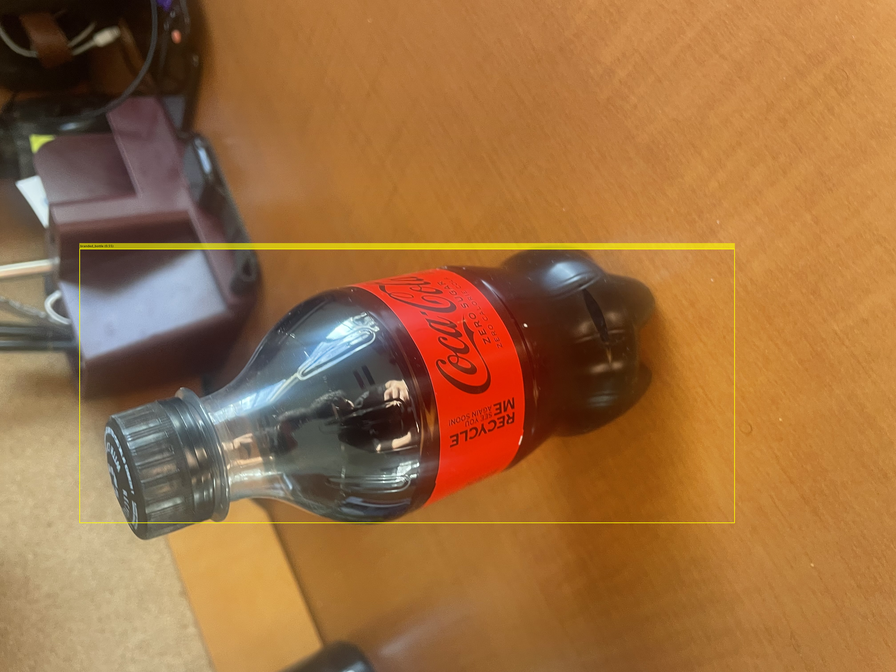

# Branded vs Generic Bottle Detection (YOLOv2 + MATLAB)

This project builds a full computer vision pipeline that detects and classifies **branded** vs **generic** bottles from real-world images using **YOLOv2** in MATLAB.  
From data collection and labeling to model training and inference, the system was designed and evaluated end-to-end with measurable outcomes.

## Why this project matters

- Demonstrates practical **ML engineering ownership** across the full lifecycle (data, model, evaluation, deployment-ready inference script).
- Solves a realistic visual classification problem with **small custom data** and no prebuilt benchmark.
- Produces strong quantitative performance on held-out images while documenting limits and failure cases.

## Project Snapshot

- **Problem:** Distinguish branded vs generic bottles in photos with varying lighting, angles, and distance.
- **Dataset:** 123 labeled training images (`labeled_dataset/images`) + ground truth annotations from MATLAB Image Labeler.
- **Model:** YOLOv2 detector with a ResNet-50 backbone.
- **Framework:** MATLAB R2025a, Computer Vision Toolbox, Deep Learning Toolbox.
- **Artifacts:** Trained model (`models/bottleDetector.mat`) and training logs (`models/trainingInfo.mat`).

## Results (Measured)

### Training Outcomes

- Mean anchor box IoU: **0.815**
- Final training RMSE: **~0.39**
- Final training loss: **~0.2**
- Training duration: **~9 minutes** (CPU training, 20 epochs)

### Inference Outcomes (20 test images)

Using `test_results/detection_summary.csv`:

- **Overall image-level success:** 19/20 (**95%**)
- **Branded bottle success:** 10/10 (**100%**)
- **Generic bottle success:** 9/10 (**90%**)
- **Observed failure mode:** one false positive count in a generic scene (detected two bottles where one existed)

Sample detection image:



## Project Demo Recording

Watch the full project presentation and walkthrough:

[Watch Demo Recording](https://psu.mediaspace.kaltura.com/media/1_a6za0cxo)

Direct link: [https://psu.mediaspace.kaltura.com/media/1_a6za0cxo](https://psu.mediaspace.kaltura.com/media/1_a6za0cxo)

## Visual Results

Example detections produced by `run_inference.m`:

| Example                       | Output            |
| ----------------------------- | ----------------- |
| Branded bottle detection      | Branded detection |
| Generic bottle detection      | Generic detection |
| Failure case (over-detection) | Failure case      |

## Technical Approach

### 1) Data Collection and Labeling

- Captured a custom dataset with variation in perspective, lighting, and partial occlusions.
- Labeled bottles into two classes:
  - `branded_bottle`
  - `generic_bottle`
- Exported a MATLAB `groundTruth` object (`labeled_dataset/bottleGroundTruth.mat`).

### 2) Training Pipeline

Implemented in `train_yolov2.m`:

- Converts `groundTruth` into datastores for object detector training.
- Resizes images and bounding boxes to YOLO input size (**416x416**).
- Estimates **5 anchor boxes** with K-means-based anchor estimation.
- Builds YOLOv2 detector on top of **ResNet-50** feature backbone.
- Trains with Adam optimizer and saves model artifacts.

### 3) Inference and Reporting

Implemented in `run_inference.m`:

- Loads `models/bottleDetector.mat`.
- Runs detection over all files in `test_images`.
- Writes annotated images to `test_results`.
- Exports per-image summary metrics to `test_results/detection_summary.csv`.

## Repository Structure

```text
finalProject/
├── train_yolov2.m                 # Training script (data prep, anchors, training, save model)
├── run_inference.m                # Inference script (predict, annotate, export metrics)
├── labeled_dataset/
│   ├── images/                    # 123 training images
│   └── bottleGroundTruth.mat      # MATLAB Image Labeler annotations
├── models/
│   ├── bottleDetector.mat         # Trained detector artifact
│   └── trainingInfo.mat           # Training metadata
├── test_images/                   # Held-out images for evaluation
└── test_results/
    ├── *_detected.png             # Annotated detections
    └── detection_summary.csv      # Inference summary
```

## How to Run

> Run from project root in MATLAB.

- **Train:** Open `train_yolov2.m` and run it to generate model artifacts in `models/`.
- **Infer:** Open `run_inference.m` and run it to process `test_images/` and export outputs to `test_results/`.

## Engineering Strengths Demonstrated

- End-to-end vision pipeline design and implementation.
- Practical transfer learning with YOLOv2 + ResNet-50.
- Data-centric ML workflow (custom labeling, anchor estimation, reproducible outputs).
- Metric-driven evaluation and transparent analysis of limitations/failure cases.
- Strong debugging and iteration workflow to stabilize MATLAB datastores and training code.

## Limitations and Next Improvements

- Expand dataset scale and class diversity to improve generalization.
- Add stronger augmentation (blur, low-light, motion) to address known failure conditions.
- Evaluate mAP/precision-recall metrics in addition to image-level success.
- Package model as a lightweight demo app (or REST endpoint) for deployment showcase.

## Context

Created as part of **CMPSC 489** (Dec 2025), with a focus on applying modern object detection workflows to a custom real-world classification task.
